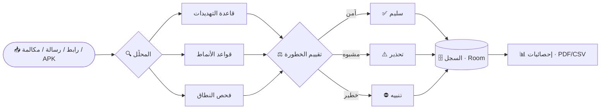

<div align="center">


# 🛡️ أمان — Keep Safe

**حارسك الشخصي ضد الاحتيال والتصيّد الإلكتروني**

<br/>


[](https://github.com/NULL200OK/keep-safe/actions)


[](https://github.com/NULL200OK/keep-safe/stargazers)
[](https://github.com/NULL200OK/keep-safe/commits/main)

**[✨ الميزات](#-الميزات) · [🧠 كيف يعمل](#-كيف-يعمل) · [🧱 التقنيات](#-التقنيات) · [🚀 البناء](#-البناء-والتشغيل) · [🗂️ الهيكل](#️-هيكل-المشروع) · [🤝 المساهمة](#-المساهمة)**

</div>

---

## 🌟 نظرة عامة

**أمان (Keep Safe)** تطبيق أندرويد متكامل لحمايتك من الاحتيال والتصيّد الإلكتروني. يفحص الروابط والرسائل والمكالمات وملفات APK وشبكات الواي فاي، ويضيف حماية للأطفال وقفلًا بالبصمة أو الرمز السري — بواجهة عصرية مبنية بـ **Jetpack Compose** وتدعم **5 لغات**.

> 🔒 **الخصوصية أولًا:** الفحص يتم على جهازك، بدون حسابات.

<table>
<tr>
<td align="center" width="25%">🔗<br/><b>روابط</b><br/><sub>Punycode / Homograph</sub></td>
<td align="center" width="25%">💬<br/><b>رسائل</b><br/><sub>SMS والبريد</sub></td>
<td align="center" width="25%">📞<br/><b>مكالمات</b><br/><sub>كشف الاحتيال والمزعجين</sub></td>
<td align="center" width="25%">📦<br/><b>APK</b><br/><sub>تحليل التطبيقات</sub></td>
</tr>
</table>

---

## ✨ الميزات

| | الميزة | الوصف |
|---|---|---|
| 🔗 | **فحص الروابط** | كشف هجمات Punycode وHomograph والنطاقات المنتحلة، مع قاعدة تهديدات قابلة للتحديث |
| 📦 | **تحليل APK** | فحص الملفات المشبوهة قبل تثبيتها |
| 💬 | **فحص SMS والبريد** | اكتشاف رسائل التصيّد مع إشعارات ذكية |
| 📞 | **فحص المكالمات** | تنبيه للأرقام الاحتيالية والمزعجة |
| 📶 | **ماسح Wi-Fi** | تقييم أمان الشبكة المتصل بها |
| 🔳 | **ماسح QR** | تحقق من وجهة الرمز قبل فتحه |
| 🌐 | **VPN محلي** | فلترة حركة المرور على الجهاز |
| 👨‍👩‍👧 | **حماية الأطفال** | فلتر DNS للعائلة وإعدادات رقابة أبوية |
| 🔑 | **فحص التسريبات** | تحقق من تعرّض بياناتك للاختراق |
| 🛠️ | **فحص أمان الجهاز** | مراجعة إعدادات الجهاز الحساسة |
| 🧬 | **القفل** | بصمة الإصبع أو رمز PIN |
| 📊 | **إحصائيات وتقارير** | سجل الفحوص، ملخص يومي وتقرير أسبوعي، تصدير **PDF / CSV** |
| 🌍 | **5 لغات** | العربية · English · Français · Español · Türkçe |

<details>
<summary><b>🔎 تفاصيل أكثر (اضغط للتوسيع)</b></summary>

<br/>

- **Punycode / Homograph:** يكشف النطاقات ذات الأحرف المتشابهة المنتحلة لمواقع معروفة.
- **تحديث التهديدات:** عامل خلفي يحدّث قاعدة التهديدات دوريًا.
- **التقارير:** ملخص يومي وتقرير أسبوعي عبر WorkManager.
- **الإقلاع:** استعادة الحماية تلقائيًا بعد إعادة تشغيل الجهاز.

</details>

---

## 🧠 كيف يعمل



---

## 🧱 التقنيات

<div align="center">


</div>

| الطبقة | المكتبات |
|---|---|
| الواجهة | Jetpack Compose · Material 3 · Splash Screen API |
| البيانات | Room · Security-Crypto |
| الخلفية | Kotlin Coroutines · WorkManager · VpnService · CallScreeningService |
| الأمان | AndroidX Biometric · PIN Lock |
| المسح | ZXing |

---

## 🚀 البناء والتشغيل

### ⚡ تلقائيًا عبر GitHub Actions
كل دفع إلى `main` يبني ملف **APK** تلقائيًا — حمّله من تبويب [Actions](https://github.com/NULL200OK/keep-safe/actions) ← آخر تشغيل ← **Artifacts**.

### 🛠️ محليًا

**المتطلبات:** Android Studio · JDK 17 · Android SDK 34

```bash
git clone https://github.com/NULL200OK/keep-safe.git
cd keep-safe
gradle wrapper --gradle-version 8.7
./gradlew assembleDebug
```

الملف الناتج: `app/build/outputs/apk/debug/app-debug.apk`

<details>
<summary><b>🔐 البناء الموقَّع (Release)</b></summary>

<br/>

أنشئ ملف `keystore.properties` في جذر المشروع (مستبعد من Git عمدًا):

```properties
storeFile=keepsafe-release.jks
storePassword=******
keyAlias=******
keyPassword=******
```

> ⚠️ لا ترفع ملفات `.jks` أو كلمات السر إلى المستودع أبدًا.

</details>

---

## 🗂️ هيكل المشروع

```text
app/src/main/java/com/nabilhassan/keepsafe/
├── screens/      شاشات الواجهة (الرئيسية، الإعدادات، VPN، Wi-Fi، QR …)
├── security/     القفل بالبصمة/PIN، فحص أمان الجهاز، فحص التسريبات
├── family/       فلتر DNS وإعدادات حماية العائلة
├── services/     VPN المحلي وفحص المكالمات
├── receivers/    استقبال SMS والتشغيل عند الإقلاع
├── workers/      التحديث الدوري والتقارير
├── export/       تصدير PDF و CSV
├── settings/     الإعدادات واللغات
└── ui/theme/     الألوان والخطوط والثيم
```

---

## 🗺️ خارطة الطريق

- [x] فحص الروابط والرسائل والمكالمات وAPK
- [x] VPN محلي وحماية الأطفال
- [x] قفل بالبصمة / PIN وفحص التسريبات
- [x] تقارير وتصدير PDF / CSV
- [ ] مزيد من اللغات
- [ ] تحسين قاعدة التهديدات

---

## 🤝 المساهمة

المساهمات مرحّب بها! افتح **Issue** أو أرسل **Pull Request**.

1. اعمل Fork للمشروع
2. أنشئ فرعًا: `git checkout -b feature/my-feature`
3. أرسل التعديلات: `git commit -m "Add my feature"`
4. افتح Pull Request

---

## 👥 الفريق والشكر

| الدور | الاسم |
|---|---|
| 🧑‍💻 **التصميم والتطوير** | **نبيل حسن** — [@NULL200OK](https://github.com/NULL200OK) |
| 🛠️ **المساعدة والمساهمة** | **dr2b** — [@Dr2b](https://github.com/Dr2b) |

---

## 📜 الرخصة

مرخّص بموجب **MIT** — راجع [LICENSE.md](LICENSE.md).

<div align="center">

**© 2026 Nabil Hassan (NULL200OK)**

إن أعجبك المشروع، لا تنسَ ⭐ النجمة!


</div>
